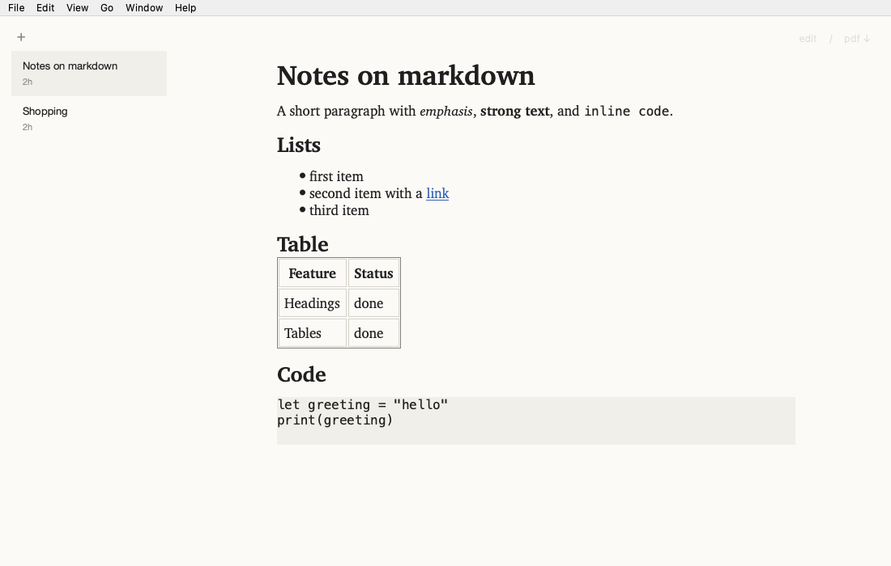
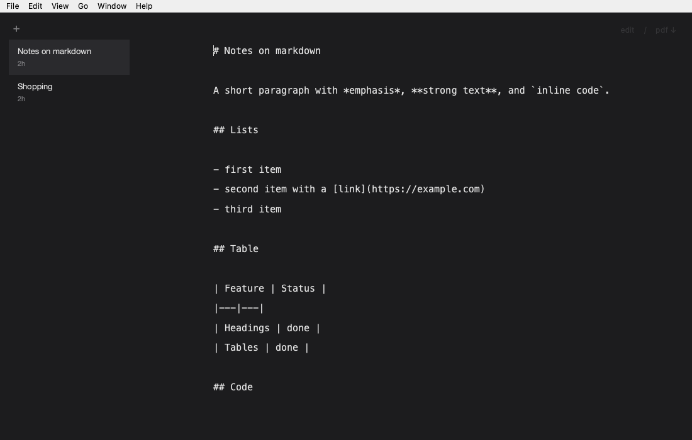

# md

Ultraminimal markdown buffers. One window, one pane at a time: either the editor or the rendered preview. Every edit saves itself. There is no save button and no file dialog.



| Edit (dark) | View (light) |
| --- | --- |
|  |  |

## Features

- **Buffers, not files.** Every buffer is a markdown file stored in your data folder. Its title is the first `#` heading.
- **Autosave.** Edits are written 300 ms after you stop typing, through a safe-write.
- **Two modes.** Edit with a monospace editor, or view a GitHub-flavoured preview (tables, fenced code, lists, links).
- **PDF export.** `Ctrl+P` writes `<title>.pdf` to your Downloads folder. A `saved · reveal` note appears for three seconds.
- **Quiet chrome.** The `edit / pdf ↓` overlay sits at 25% opacity and comes up to full strength on hover.
- **Tray icon.** Keep md running in the menu bar, pick a recent buffer, or hide the Dock icon (macOS).
- **Single instance.** Launching md again brings the existing window forward.

## Quick start

Requires macOS 12 or later on Apple silicon, Qt 6.8, and CMake 3.25 or later. The macOS build is the verified target; Linux builds have not yet been verified.

```sh
cmake --preset dev && cmake --build --preset dev
ctest --preset dev --output-on-failure
open build/dev/md.app
```

To build a `.dmg` for distribution, run `packaging/macos/package.sh` (see [docs/building.md](docs/building.md)).

## Documentation

- [Usage and shortcuts](docs/usage.md)
- [Building, testing and packaging](docs/building.md)
- [Architecture and design rules](docs/architecture.md)
- [Phase checklist](docs/PLAN.md)

## Licence

No licence has been chosen yet.
