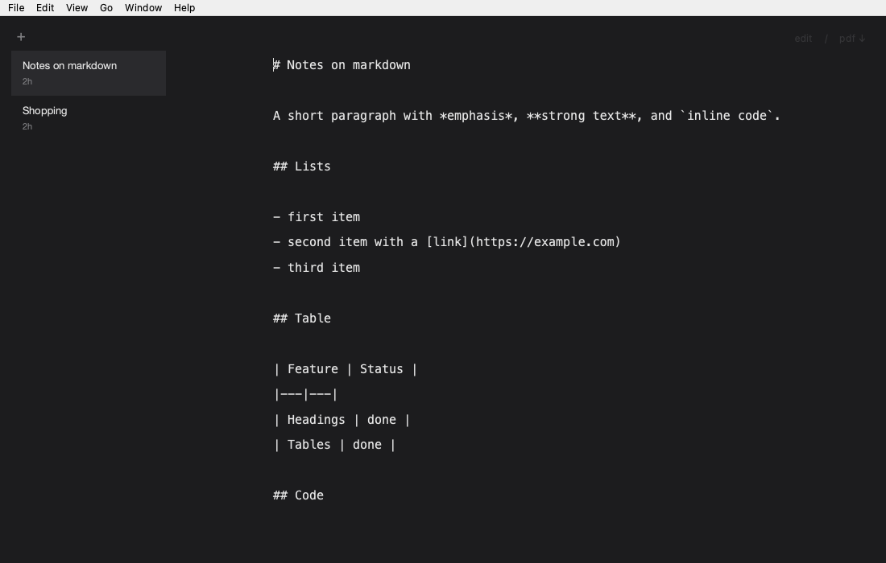

# Usage

## The window

md shows one pane at a time: the **editor** (monospace, plain text) or the **preview** (rendered markdown). There is no split view.

- The **sidebar** on the left lists your buffers, newest first. Each row shows the buffer's title and how long ago it was edited.
- The **overlay** in the top right shows `edit / pdf ↓`. It sits at 25% opacity and comes to full strength when you hover over it.
- Double-click the preview to go back to the editor.

## Buffers

- A buffer's title is the first line that starts with `#`, with leading `#` and inline `*`, `_` and `` ` `` removed. If there is no such line the title is `untitled`. Titles are truncated at 60 characters and cannot be renamed.
- Edits are saved 300 ms after you stop typing. There is no save button.
- Pressing `+` (or `Ctrl+N`) creates a buffer. If the current buffer is still empty, md reuses it instead.
- An empty buffer is deleted when you switch away from it.
- `Ctrl+Backspace` deletes the current buffer. You are asked to confirm only when it has content.

## PDF export

`Ctrl+P` (or the `pdf ↓` overlay button) writes `<title>.pdf` to your Downloads folder. If the file already exists, md writes `<title> (2).pdf`, then `(3)`, and so on. The overlay shows `saved · reveal` for three seconds; clicking `reveal` opens the file in Finder.

## Keyboard shortcuts

On macOS, `Ctrl` in this table is shown as `⌘`.

| Action | Shortcut |
| --- | --- |
| New buffer | `Ctrl+N` |
| Export PDF | `Ctrl+P` |
| Delete buffer | `Ctrl+Backspace` |
| Toggle edit / preview | `Ctrl+E` |
| Toggle sidebar | `Ctrl+\` |
| Previous buffer (preview mode) | `Ctrl+Up` |
| Next buffer (preview mode) | `Ctrl+Down` |
| Minimise | `Ctrl+M` |
| Insert two spaces (editor) | `Tab` |

## Tray icon and Dock

- Closing the window hides it when the tray icon is available, so md keeps running.
- The tray menu lists the five most recent buffers, has a Show/Hide toggle and a Quit item.
- View > Hide Dock Icon (macOS) runs md as a menu bar app. The setting is remembered.
- Launching md while it is already running brings the existing window to the front.

## Where your data lives

| Item | Location (macOS) |
| --- | --- |
| Buffers | `~/Library/Application Support/md/buffers/*.md` |
| Window state and preferences | macOS user settings store (QSettings), or the file passed with `--settings-file` |

Buffers are plain markdown files, so you can back them up, sync them, or open them in another editor. Edits made outside md are picked up while md is open.

For testing, pass `--data-dir`, `--downloads-dir` and `--settings-file` to keep md away from your real data. See [building.md](building.md).

## Gatekeeper (unsigned builds)

The `.dmg` produced by `packaging/macos/package.sh` is not notarised. The first time you open `md.app`, either:

- right-click `md.app` and choose **Open**, then confirm, or
- run `xattr -cr /Applications/md.app` in Terminal.
